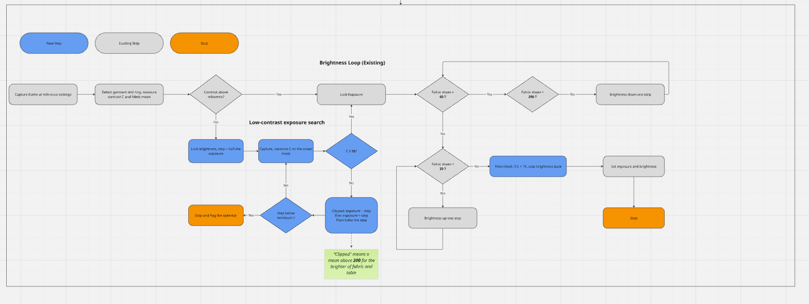

# Auto exposure test bench

Auto exposure for the garment scanner (Daheng USB camera looking down at a white table).
The code in `auto_exposure.py` finds an exposure and gain so that:

1. the garment stands out from the table (enough **contrast**), and
2. the garment itself is not too dark or too bright (its **texture and seamlines are visible**).

## Words used

| Word | Meaning |
|---|---|
| **Garment mask** | The pixels of the garment, found with OpenCV rules (`garment_separation.py`, no AI model). |
| **Ring** | A band of table just around the garment (gap 0.6 %, width 3 % of the long side). |
| **Fabric mean (F)** | Mean grey level (0-255) inside the garment mask. |
| **Table mean (T)** | Mean grey level inside the ring. |
| **Contrast (C)** | `|F - T|`. How much the garment differs from the table. |
| **Clipped** | The brighter of F and T is above **200**. Detail is being lost to white. |
| **Exposure** | How long the sensor collects light, in microseconds (µs). 2 000 - 150 000 µs. |
| **Gain** | Electronic brightness boost in dB. 2 - 24 dB. +6 dB is about twice as bright. |
| **Reference** | Values measured once from a reference image (`image.png`) and saved in `calibration.json`. The run starts at the reference's camera settings. |

## The key idea

Until the picture clips, **brightness grows in a straight line with exposure**.
Double the exposure and F, T and C all double. So after one photo we can
**calculate** the exposure we need, instead of trying many exposures one by one.
Every extra photo costs about 0.5-1 s (the camera needs time to deliver a frame at the new settings),
so fewer photos means a faster run.

## How it works



This is the original flowchart. The code follows it, but calculates the exposure and the gain instead of
stepping ("exposure +/- step, halve the step", "brightness up/down one step"), and uses C >= 6 instead of 15.
The steps below describe what the code does.

### Step by step

1. **Photo at the reference settings.** If the camera already has these settings, there is no wait.
2. **Find the garment and the ring once.** The masks are saved. The garment does not move, so every
   later photo is measured on the same masks (finding the garment takes 0.2-0.5 s, measuring takes 0.02 s).
3. **Contrast above the reference?**
   - **Yes:** the exposure is good. Go to step 5.
   - **No:** go to step 4 (the low-contrast exposure search). The gain is locked.
4. **Low-contrast exposure search**
   - No garment found (often a white garment on a white table that is too bright): halve the exposure
     and look again.
   - **C ≥ 6:** done, lock the exposure.
   - **Clipped:** halve the exposure and measure again. Clipped numbers cannot be used for the calculation.
   - **Not clipped:** calculate two exposures:
     - `E_need = E × 6 × 1.3 / C`: the exposure that gives C = 6 (1.3 is a safety margin).
     - `E_clip = E × 200 / max(F, T)`: the exposure where the picture starts to clip.
     - If C cannot reach 6 before `E_clip`, no exposure will work: **stop and flag the operator** at once.
     - Otherwise take one photo at the smaller of the two and check again. At most 2 calculated tries.
5. **Brightness (gain).** The exposure is locked now.
   - F between 60 and 200: keep the gain.
   - Otherwise calculate the gain for F = 120: `new gain = gain + 20 × log10(120 / F)`, take one photo.
   - **Final check:** if C dropped below 6 with the new gain, put the old gain back.
6. **Set and save** exposure and gain to `calibration.json`. The final image and overlay are saved to
   `captures/` in the background, after the result is printed.

Limits: at most 12 photos in one run, exposure 2 000-150 000 µs, gain 2-24 dB.

## Examples

### Example 1: white t-shirt on a white table (real run on the device)

```
photo: 25000 us, gain 12 -> no garment              table too bright, no outline
photo: 12500 us, gain 12 -> no garment              exposure halved, still no outline
photo:  6250 us, gain 12 -> C 12.6, fabric 176.1, table 163.5
exposure locked at 6250 us                          C 12.6 >= 6
fabric mean 176.1: gain 12                          F is between 60 and 200, keep the gain
set and saved: 6250 us, gain 12
```

At 25 000 µs the table and the shirt were both almost white, so there was no outline to find.
Halving the exposure twice brought back the outline and a contrast of 12.6.

### Example 2: calculating the exposure (light briefs in dim light, simulated)

```
photo: 25000 us, gain 12 -> C 1.6, fabric 25.5, table 23.9
computed exposure: need 121159 us, clips at 196315 us -> 121160 us
photo: 121160 us, gain 12 -> C 7.9, fabric 123.0, table 115.1
exposure locked at 121160 us
```

C is only 1.6 and nothing is clipped, so:

- `E_need = 25 000 × 6 × 1.3 / 1.6 ≈ 121 000 µs`
- `E_clip = 25 000 × 200 / 25.5 ≈ 196 000 µs`

`E_need` is below `E_clip`, so one photo at 121 160 µs is enough: C = 7.9. The old step-by-step search
needed 5 photos here and still gave up.

### Example 3: no exposure can work (white t-shirt, simulated)

```
photo: 25000 us, gain 12 -> C 0.7, fabric 181.3, table 180.5
C 0.7 cannot reach 6 before clipping (at 27580 us C would be 0.8)
!!! OPERATOR: no exposure gives this garment enough contrast against the table.
```

The shirt and the table have the same brightness. Even at the clipping point (27 580 µs) C would only
be 0.8, so the operator is told after one photo instead of five.

### Example 4: calculating the gain (overexposed white t-shirt, simulated)

```
photo: 25000 us, gain 12 -> C 27.0, fabric 201.4, table 228.5
exposure locked at 25000 us                         C 27 >= 6
fabric mean 201.4 is outside 60-200: gain 12 -> 7.5
photo: 25000 us, gain 7.5 -> C 16.1, fabric 119.4, table 135.5
```

`12 + 20 × log10(120 / 201.4) = 7.5 dB`, and one photo later the fabric mean is 119.4, close to 120.

## Running it

```bash
./run.sh                                         # stops rms-app, runs auto exposure with a live window
sudo python3 auto_exposure.py                    # the same, without run.sh (stop rms-app first)
python3 auto_exposure.py --reference             # measure image.png, save the reference
python3 auto_exposure.py --reference other.png   # another reference image
sudo systemctl start rms-app                     # afterwards: start the scanner app again
```

Live window keys: `a` run auto exposure again, `o` overlay on/off, `s` save the frame, `q` quit.
Always quit with `q`; otherwise the camera can stay open and the next run cannot open it.

`--reference` saves the camera settings that are in `calibration.json` at that moment as the start
settings. Put the settings the reference image was taken with in `calibration.json` first.

## Files

| File | What it is |
|---|---|
| `auto_exposure.py` | The algorithm above, the live window and `--reference`. |
| `garment_separation.py` | Finds the garment and the ring (OpenCV rules, no AI model). |
| `capture.py` | Daheng camera and `PreProcessor` (rotate, crop, undistort). Copied from the scanner app, not changed. |
| `calibration.json` | Camera settings, crop and the saved reference. |
| `run.sh` | Starts it on the Linux device. |

## Known issue

When the picture is clipped and the exposure goes down, the camera's frame changes less than the
code expects, so the code can wait up to 6 s for a "new" frame (seen in Example 1: one wait took 6.07 s,
the whole run 8.9 s). A fix is planned: treat a frame as new once it moves 5 grey levels in the expected
direction.
